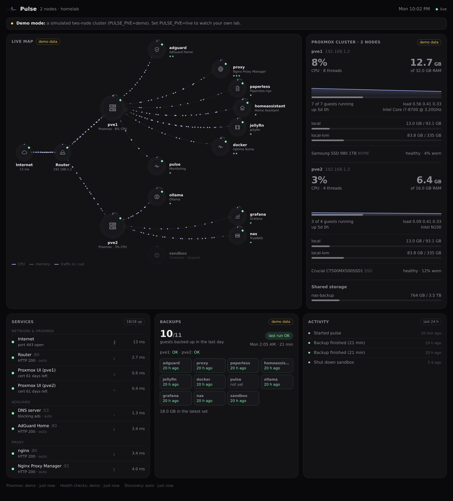
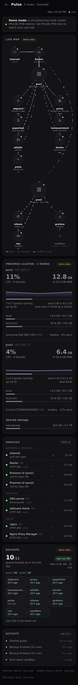

# Homelab Pulse

A live, animated map of your Proxmox homelab on one page, and it **figures out the lab by itself**.
Install it and it finds every node, VM and container, their IP addresses, and the services they run
(web apps, DNS, MQTT, databases…), then keeps checking that those services answer. Guests you create
later show up within a minute. You don't edit a config file.



Every guest is a node on the map. Its outer ring fills with CPU (it glows when busy and turns amber
above 88 %), a thin second ring shows memory, small dots under its name show its services, and
particles stream along the links in proportion to real network traffic (indigo = in, white = out).
Around the map are panels for each Proxmox node (CPU history, RAM, storage, SMART health), the health
checks grouped by guest, last night's backups per guest, and a 24-hour activity feed. Tap any node
for details and 30-minute sparklines.

<p align="center"></p>

## Install

On a Proxmox VE host (9.x recommended; 8.x works with the caveat below), as root:

```bash
bash -c "$(curl -fsSL https://raw.githubusercontent.com/3g15h1/homelab-pulse/main/install.sh)"
```

The installer:

1. creates an unprivileged Debian 13 container (1 core, 512 MB, 4 GB, next free ID, DHCP, tagged `homelab-pulse`),
2. creates a Proxmox user `pulse@pve` with the built-in read-only role **PVEAuditor** and an API token
   `pulse@pve!ct<vmid>` for this container,
3. installs Pulse as a systemd service and prints its address.

Options: `--vmid`, `--storage`, `--bridge`, `--ip 192.168.1.60/24 --gw 192.168.1.1`, `--ref <tag>`,
`--dry-run` (prints every change and makes none). `install.sh --help` lists them all.

**Upgrade:** run the same command again. It finds the container by its tag, keeps the token, the CA
and your settings, and keeps the previous version in `/opt/homelab-pulse.prev`.

Add it to a phone's home screen (Share → Add to Home Screen) and it opens like an app. `?embed` hides
the header and footer, for embedding in another dashboard such as a Home Assistant webpage card.

## How discovery works

```
every 5 s    node + guest stats from /cluster/resources and each node's status
every 60 s   guest IPs, SMART, backups (vzdump task logs), Proxmox task log
every 5 min  discovery: scan each running guest, identify what answers, update the checks
             (a guest that was just created or started is scanned 45 s later)
every 15 s   run the health checks, 8 at a time; a check turns red after 2 failures in a row
```

- **IP addresses** come from the Proxmox API: a container's live interfaces, the QEMU guest agent for
  VMs, or a static `ip=` / cloud-init address in the guest's config.
- **Scanning:** Pulse tries a TCP connection to about 30 common ports (22, 53, 80, 443, 1883, 3000,
  5432, 8000, 8080, 8123, 8443, 9000, 11434, 32400…) on each running guest's address, and ports 80/443 on
  the router. It scans **only the addresses Proxmox reports for your guests**, never the rest of your
  network.
- **Fingerprinting:** each open port gets one harmless look: an HTTP `GET /` (following at most one
  redirect to the same host), a TLS handshake (certificate name and expiry), a DNS query (and whether it
  blocks ads), or the greeting line of protocols like SSH. Pulse never logs in and never sends a form.
- **Recognising software:** the page title, `Server` header, certificate and port are matched against a
  list of common homelab software (Home Assistant, AdGuard Home, Pi-hole, Paperless-ngx, Nextcloud,
  Jellyfin, Plex, Immich, Grafana, Uptime Kuma, Portainer, Nginx Proxy Manager, Vaultwarden, Gitea,
  Frigate, Node-RED, Ollama, TrueNAS, Proxmox Backup Server and more). The best match becomes the guest's
  role and icon. Unknown web apps are labelled with their page title.
- Every recognised service gets a health check, except SSH. SSH is listed on the guest, but checking it
  every 15 s would fill sshd's log, so it isn't checked unless you add the check in `overrides.json`.
  Ports like Redis, PostgreSQL, MQTT and FTP are only connected to and never sent an HTTP request.
- A service has to be missing from **two scans in a row** before it is dropped, so a guest that reboots
  during a scan doesn't lose its checks. Checks for a stopped guest are paused (grey), not red.
- **Clusters:** every node gets its own hub on the map and its own panel. Guests move with migrations.

## Fine-tuning

Discovery needs no help, but you can steer it.

**Proxmox tags on a guest** (Datacenter → guest → Summary → Tags):

| Tag | Effect |
|---|---|
| `pulse-ignore` | Hide the guest completely |
| `pulse-noscan` | Show the guest but don't scan it |
| `pulse-role-shared-ai` | Role text ("shared ai"; dashes become spaces) |
| `pulse-icon-brain` | Icon (home, shield, doc, film, photo, chart, database, terminal, code, lock, flow, radio, sync, disk, cube, globe, camera, brain, chat, key, flask, spark, pulse, box) |
| `pulse-ip-192-168-1-50` | Address to use (dots as dashes) |

**`/etc/homelab-pulse/overrides.json`** in the container, for anything tags can't say. All keys are
optional. See `overrides.example.json`:

```json
{
  "internet": {"host": "1.1.1.1", "port": 443},
  "router": {"name": "Router", "ip": "192.168.1.1"},
  "scan": {"ports_add": [8384], "ports_remove": [21]},
  "guests": {"103": {"role": "Home Assistant", "icon": "home", "ip": "192.168.1.13"}},
  "checks": [{"id": "public-cert", "name": "Public HTTPS", "kind": "tls", "host": "192.168.1.11",
              "port": 443, "sni": "home.example.org", "target": 101}],
  "hide_checks": ["101:22"]
}
```

`internet: false` turns the Internet check off. `checks` adds a check (kinds `tcp`, `http`, `tls`, `dns`).
One whose `target` and port match a discovered check replaces it. Use that for a fully verified TLS check
with the right server name. `hide_checks` removes checks by id (`<vmid>:<port>`). The file is re-read
every minute. A mistake in it shows on the dashboard and doesn't stop discovery.

Precedence: guest tags, then `overrides.json`, then discovery, then a guess from the guest's name.

## Configuration

`/etc/homelab-pulse/env` (see `env.example`): `PULSE_PVE` (`live` or `demo`), `PULSE_PVE_HOST`,
`PULSE_PVE_PORT`, `PULSE_PVE_TOKEN_FILE`, `PULSE_PVE_CA`, `PULSE_PVE_TLS_NAME` (rarely needed),
`PULSE_OVERRIDES`, `PULSE_PORT`, `PULSE_BIND`, `PULSE_LOG`. Restart after editing:
`systemctl restart homelab-pulse`.

Routes: `/` UI, `/api/state` JSON snapshot, `/api/stream` Server-Sent Events, `/api/history/<vmid|node>`,
`/healthz` (503 when Proxmox, the checks or discovery are failing).

## Try it without Proxmox

```bash
git clone https://github.com/3g15h1/homelab-pulse && cd homelab-pulse
PULSE_PORT=8765 python3 pulse/server.py     # demo mode: a simulated two-node cluster
```

Python 3.11+ standard library only. There's nothing to `pip install`.

## Manual install (any Debian/Ubuntu box)

1. On a Proxmox node:
   `pveum user add pulse@pve && pveum acl modify / --users pulse@pve --roles PVEAuditor && pveum user token add pulse@pve dash --privsep 0`
2. On the box: copy `pulse/` to `/opt/homelab-pulse/pulse`, `homelab-pulse.service` to `/etc/systemd/system/`,
   and create a `pulse` system user.
3. Put `pulse@pve!dash=<secret>` in `/etc/homelab-pulse/pve-token` (mode 640, group pulse), copy the node's
   `/etc/pve/pve-root-ca.pem` to `/etc/homelab-pulse/pve-ca.pem`, and write `/etc/homelab-pulse/env` from
   `env.example` with `PULSE_PVE=live` and `PULSE_PVE_HOST=<node IP>`.
4. `systemctl daemon-reload && systemctl enable --now homelab-pulse`

## Security and privacy

- **Read-only.** The token has the PVEAuditor role. Pulse can see the lab but can't change anything.
  Revoke it on its own with `pveum user token remove pulse@pve ct<vmid>`.
- **It port-scans your guests**, as described above, and only the addresses Proxmox reports for them. Tag
  a guest `pulse-noscan` to opt it out.
- **No login on the dashboard.** Anyone who can reach it sees guest names, addresses, services and backup
  state. Keep it on your LAN or a VPN such as Tailscale. Don't expose it to the internet.
- Nothing leaves your network except the Internet check (a TCP connect to 1.1.1.1:443, which you can turn off).
- Text taken from scanned services (page titles, headers) is shortened and always shown escaped.

**Proxmox VE 8:** reading a VM's addresses through the guest agent needs `VM.Monitor`, which the
read-only role doesn't have on PVE 8. Containers are unaffected. Give VMs a static IP or a `pulse-ip-…` tag.

## Uninstall

```bash
bash -c "$(curl -fsSL https://raw.githubusercontent.com/3g15h1/homelab-pulse/main/uninstall.sh)"
```

This destroys the container and its API token (`pulse@pve!ct<vmid>`). The `pulse@pve` user goes too,
unless another Pulse install still uses it.

## Development

```bash
python3 -m unittest discover -s tests -t .
```

`pulse/discover.py` is the discovery pipeline, `pulse/catalog.py` the list of recognised software and
scanned ports, `pulse/collect.py` the polling and the snapshot, `pulse/demo.py` the simulated cluster.
New software to recognise is usually a single line in `catalog.RULES`.

## License

MIT
